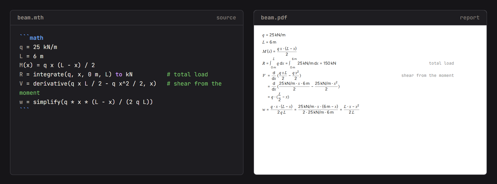
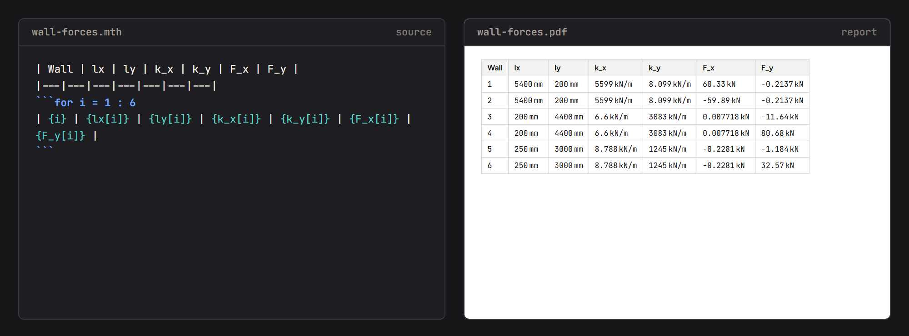
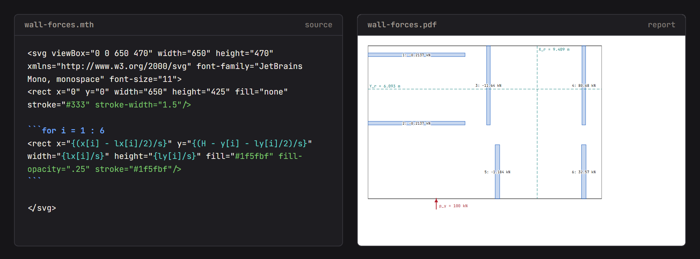
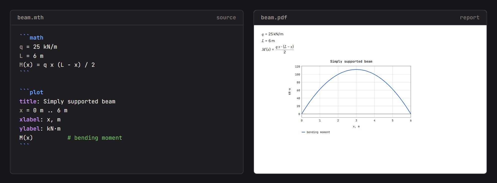

# Writing Matheos documents

A `.mth` file is CommonMark with YAML front matter and fenced `math` blocks. CommonMark is the
standard flavour of Markdown: `#` headings, paragraphs, lists, GFM tables, and fenced code
blocks between lines of three backticks; a fence tagged `math` is a calculation block. YAML front
matter is the block between two `---` lines at the top, one `key: value` per line, holding the
title, author and other metadata of the report. Statements run top to bottom; every derived statement prints formula, substituted values and result; every `check`
prints a verdict and the utilization η. Start from the closest file in
`examples/` (https://github.com/Suharevillya/matheos/tree/main/examples); `steel-beam.mth` is
the canonical template.

## 1. Front matter

```yaml
---
title: Simply supported floor beam
project: Example building, axis B
author: Name
date: 2026-10-15
revision: A
code: EN 1993-1-1 + Finnish NA
---
```

Optional: `logo: file.png`, `logo_width: 40` (mm), `digits: 4`.

## 2. Statements, one per line inside ```` ```math ```` fences

| Form | Example | Prints |
|---|---|---|
| input | `L = 6.0 m        # span` | `L = 6.0 m` + caption |
| derived | `M_Ed = q_Ed * L^2 / 8` | formula = substituted = result |
| bare expression | `c_f / t_f` | the three stages, no name |
| check | `check M_Ed <= M_c_Rd` | both sides with values, ✓/✗, η |
| conditional | `if c_f / t_f <= 9 eps` … `else if` … `else` … `end` | taken branch only, after its condition |
| comment | `# own line` or trailing `# caption` | nothing / right-aligned caption |

An input is a literal number with an optional unit. Anything else is derived. `check` needs the
keyword; a bare comparison is just a boolean. Rebinding a name is allowed; last wins.

## 3. Identifiers

`[A-Za-z_][A-Za-z0-9_]*`. First `_` opens a subscript, later `_` become commas:
`W_pl_y` → W_{pl,y}, `M_c_Rd` → M_{c,Rd}. Spelled Greek renders as the letter:
`gamma_M0`, `alpha_cc`, `eps`, `lambda`, `eta`, `phi`, `delta`, `sigma`. Trailing `'` is a prime.
An accent right after a Greek base decorates it: `lambda_bar_y` → λ̄_y (`_bar`, `_hat`,
`_tilde`); a Latin `d_bar` keeps "bar" as its subscript.

## 4. Units

Write the unit after the number: `25 kN/m`, `355 MPa`, `8356e4 mm^4`, `60 kNm/m`. Available:
`mm cm m km`, `g kg t`, `s`, `N kN MN`, `Nm kNm MNm`, `Pa kPa MPa GPa`, `rad deg`, `K`,
`J kJ W kW`, and compounds with `^`, `*`, `/` (`kN/m^2`, `N/mm^2`). Units combine through
arithmetic; a result prints in a sensible default (mm, kN, kN·m, kN/m, MPa) unless you end the
statement with `to <unit>`: `M_c_Rd = W_pl_y * f_y / gamma_M0 to kNm`. `to` never changes the
stored value. A bound name wins over a unit of the same spelling (`t = 10 mm` makes `t` a
variable from then on). Adding a number to a quantity, or comparing them, is an error.

Engineering guidance: SI inputs with a unit on every literal. `to` on every resistance so the
report reads in kN and kN·m. A `check` for every demand/capacity pair. Captions carry clause
numbers (`# (6.13)`). Prose explains; math computes. Mind `a / b c` = a/(b·c): implicit
multiplication binds tighter than `/`; write `a / b * c` for (a/b)·c.

## 5. Checks and η

`check <expr> <op> <expr>` with `<=`, `>=`, `<`, `>`, `==`, `!=`. η = left / right (right / left for
`>=` and `>`). Text values compare as text: `curve = "b"`, `alpha = curve == "b" ? 0.34 : 0.49`,
`check curve == "b"` (verdict, no η). `not a` negates a boolean. Write one check per demand/capacity pair. `check a <= b warn 80%` keeps the
fail line at 100 % but flags a pass above 80 % with a yellow badge. A range is one line:
`check 0.25 <= beta <= 1`. A ternary may sit inside a check when bracketed. In prose,
`{U to %}` shows a value in a display unit. `check a <= b if cond` applies only when `cond`
holds (n/a badge otherwise). A failure mode that does not apply is `na`: `N_ps = beta <= 0.85
? … : na`; `min(…)` skips it and a check against it reads n/a. `solve(expr, x, lo, hi)` finds
the root of `expr = 0` by bisection (units carried) where a spreadsheet would goal-seek. A
moment per length shows with `to kNm/m`.

## 6. Conditionals

```
if c_f / t_f <= 9 eps
  cls = 1
else if c_f / t_f <= 10 eps
  cls = 2
else
  cls = 3
end
```

Conditions are comparisons, optionally joined with `and`, `or`, `not`. Only inside math blocks.

## 7. Inline values in prose

`{cls}` prints the value, `{M_Ed / M_c_Rd}` a computed ratio, `{F_v_Ed =}` prints `F_v,Ed = 50 kN`.

## 8. Modifiers and block options

Trailing `;` evaluates silently, trailing `:` prints the result line only. Fence options:
```` ```math hide ```` (evaluate, print nothing), ```` ```math results ```` (result lines only).

## 9. Vectors, tables, drawings, plots

- Vectors: `lx = [5400, 5400, 200] mm`, element-wise `.*` `./` `.^`, `lx[2]`, slices
  `x[2:5]`, `sum`, `max`, `dot`, `lusolve(K, F)` (returns a column: `z[3, 1]`). Keep a matrix
  homogeneous: `[0 kN, 0 kN, P]`. `sqrt`, `abs`, `exp`, `log`, `sin`/`cos`/`tan`/`sinh`/`cosh`/`tanh` (of `deg` quantities too), `min`, `max`, `pi` exist; the one-argument ones map over vectors. `pi (d - t)` is a product.
- `a (b + c)` multiplies when `a` is a variable; `f(x)` calls a function.
- `cond ? a : b` prints as cases; `U = N_Ed / N_Rd to %` shows a percentage.
- Tables: GFM Markdown tables with `{expr}` in cells. Images: `` next to the
  document. Raw `<svg>` in prose passes through, with `{(x[1] - lx[1]/2) / s}` substituted as a
  plain number (divide by `1 mm` for a bare number).
- Plots: a ```` ```plot ```` fence with `title:`, `x = 0 .. 2` (or `0 m .. 6 m`), `xlabel:`,
  `ylabel:`, one expression in `x` per line (`M(x)`, `2 - 2 x`), `(1, 0.5)` points; the
  trailing `#` comment is the legend entry.
- Includes: front matter `include: helpers.mth` (or a list) binds another document's variables
  and functions before the first block, printing nothing. Resolved next to the document (CLI),
  by document name in the web library, or through `resolve` when embedded.
- Catalogues: front matter `catalogs: { IPE: { file: IPE-props_EC3UK.json, units: { H: mm,
  Wply: cm^3 } } }`, then `sec = IPE["IPE 300"]` and `W_pl_y = sec.Wply`. Do not name the row
  variable `s`, `m` or another unit. The file sits next to the document (CLI); the web app
  bundles the IPE and HE tables.
- `integrate(q x, x, 0 m, L)` (numeric, units carried), `derivative(q x L/2 - q x^2/2, x)` and
  `simplify(expr)` (symbolic, print only).

  

- Conditional prose: ```` ```if U > 0.8 ```` … ```` ``` ```` shows the Markdown inside only
  when true; write a second fence for the other case.
- A parameter is an input ending in `?`: `L = 6.0 m ?`; a catalogue pick may carry it too
  (`sec = SHS["180X180X6"] ?`). The editor lists these as a form.
- Loops in math: `for e = 1 : n_E` … `end`, nestable, `K[i, j] = K[i, j] + k` updates one
  element; end body lines with `;` to print only what matters. Loops in prose: a
  ```````for i = 1 : n```` fence right after a table header line gives one row per `i`
  (`| {i} | {F[i]} |`); inside `<svg>` it gives one element per `i`. The variable is
  substituted only inside `{…}`.

  

  

  
- A long matrix may continue on the next lines while a bracket is open; the result prints
  after the last line. A vector with one unit prints it once: `[5.6  0.0066] kN/mm`. Lines wider than the page
  shrink to fit; keep huge matrices silent (`K = zeros(15, 15);`) and show them as tables.
